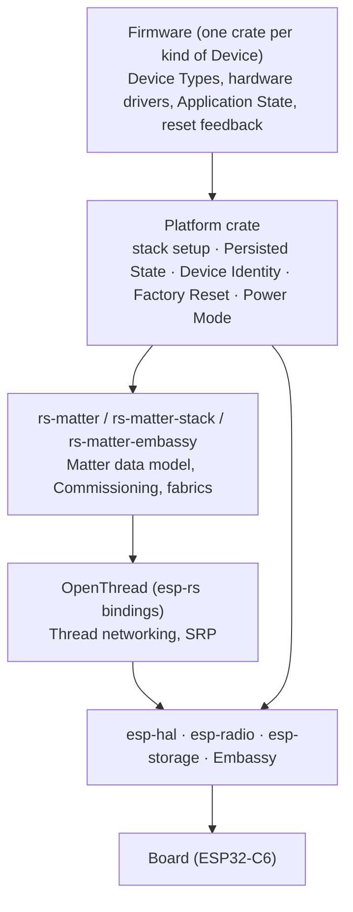
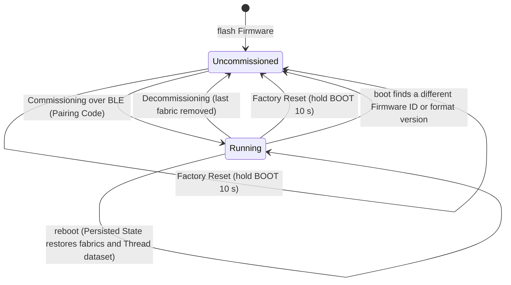

# Architecture

This repository builds self-built, personal smart-home **Devices** that speak Matter over Thread, in no_std Rust. The words used here are defined in [GLOSSARY.md](../GLOSSARY.md); the reasons behind each choice are in [docs/adr/](adr/).

> **Status (2026-11):** this describes the target shape. The repo is still a single crate with one Firmware (the WS2812 On/Off Light), and Persisted State is not implemented yet (`DummyKvBlobStore`).

## Layers

- **Firmware** describes what a Device *is*: its Device Types (Matter endpoints and clusters) and the hardware that backs them. It never touches raw store keys, flash, or identity. ([ADR 0004](adr/0004-workspace-with-platform-and-firmware-crates.md))
- **Platform** owns everything every Device has in common: bringing up the Matter stack, Persisted State, Device Identity, the Factory Reset gesture, and later Power Mode. ([ADR 0004](adr/0004-workspace-with-platform-and-firmware-crates.md))
- **Matter / Thread stack** is pure Rust on Embassy, pinned to git revisions. ([ADR 0001](adr/0001-rs-matter-embassy-over-esp-idf.md))
- **Board** is always ESP32-C6; BLE is used only during Commissioning. ([ADR 0002](adr/0002-esp32-c6-and-ble-only-for-commissioning.md))

## Device lifecycle

| Event | Commissioning State | Network State | Application State | Device Identity |
|---|---|---|---|---|
| Reboot | kept | kept | kept | unchanged |
| Decommissioning | cleared | cleared | kept | unchanged |
| Factory Reset | cleared | cleared | cleared | unchanged |
| Firmware ID / format mismatch | cleared | cleared | cleared | unchanged |
| Full flash erase | cleared | cleared | cleared | unchanged |

([ADR 0006](adr/0006-persisted-state-scope.md), [ADR 0009](adr/0009-factory-reset-instead-of-migrations.md))

## Identity and Commissioning

Device Identity is never stored. The Setup Passcode and Discriminator are derived from the factory MAC and the Build Secret, and the Thread EUI-64 from the MAC alone, so a Device's Pairing Code never changes and a label printed once stays valid. Devices use Matter test attestation permanently. An uncommissioned Always-On Device advertises over BLE until it is commissioned, with no 15-minute window, and after Decommissioning the Platform clears Network State and reboots back into that state. ([ADR 0003](adr/0003-test-attestation-with-per-device-passcode.md), [ADR 0007](adr/0007-device-identity-derived-from-mac-and-build-secret.md), [ADR 0010](adr/0010-commissioning-window-open-until-commissioned.md))

## Persisted State on flash

Persisted State lives in a dedicated `matter-kv` data partition defined by the repo's own partition table, as a key-value map with wear levelling. The Matter stack stores Commissioning State and the Thread dataset itself; the Platform adds the Firmware ID and format version and hands each endpoint its own slots for Application State. OpenThread's own settings (frame counters, parent info) are deliberately not stored. ([ADR 0006](adr/0006-persisted-state-scope.md), [ADR 0008](adr/0008-own-partition-table.md))

## Power

Every Device is an Always-On Device today. Sleepy Devices (Thread sleepy end device / Matter ICD) are the target for battery Devices but are blocked upstream; ESP32 deep sleep with a reboot on every wake was rejected. ([ADR 0005](adr/0005-sleepy-devices-as-thread-sed-not-deep-sleep.md))

## Testing

Pure logic is tested on the host with `cargo test`. Platform behaviour that needs real hardware (flash, eFuse identity, the BOOT gesture) runs as on-device tests through probe-rs on a dedicated Test Board, locally via `cargo xtask hil`; CI runs only build, clippy, and host tests. End-to-end Matter tests against a Thread Border Router are a later goal. ([ADR 0011](adr/0011-hardware-tests-on-a-dedicated-test-board.md))
